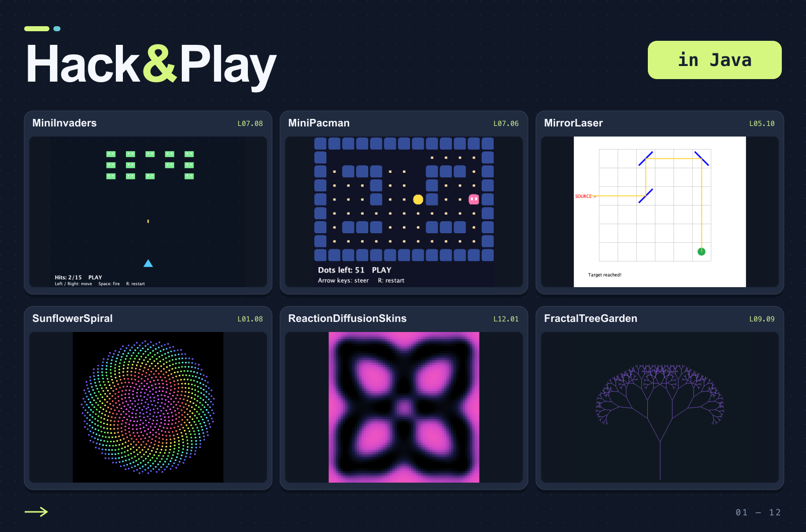

# Hack & Play in Java

**[English](https://github.com/Java-Klub/hack-and-play-in-java/tree/main) · [Česky](https://github.com/Java-Klub/hack-and-play-in-java/tree/ceska-verze)**

**Uč se Javu: prozkoumej hru, změň pravidla a hraj po svém.**

12 úrovní · 145 her, hádanek a tvořivých experimentů · 36 základních Java skills (dovedností)



Zažeň vetřelce. Proveď laser mezi zrcadly. Z několika čísel vytvoř duhovou spirálu, rozvětvený strom nebo retro zvuk.

V každé misi dostaneš spustitelný program a malou část k dokončení, opravě či změně. Předpověz, co kód udělá, proveď svůj tah, ověř jej a hraj znovu. První oprava se může vejít do dvou řádků; pozdější přidá hře nové pravidlo nebo oživí simulaci.

## Začni se učit

**[Otevři učebnici pro samostudium →](learn/README.md)**

Začneš krátkým úplným programem. Nový zápis si vysvětlíš, vyzkoušíš ho v malém úkolu a potom použiješ ve hře. Připravené jsou první dvě kapitoly: spuštění a čtení programu, pořadí příkazů, hodnoty a výpočty. Obsah ukazuje také plán dalších kapitol.

Na GitHubu čti učebnici z odkazu výše. Pro čtení offline stáhni a rozbal celou větev a otevři `learn/index.html` v prohlížeči. Příklady a hry spouštěj ve svém editoru nebo terminálu podle úvodní lekce.

## První záhada

Kreslení je připravené. Stěna je šedá. Který řádek ji schoval?

```java
void paintWall(Graphics2D g) {
    paintTiles(g);
    paintBackground(g);
}
```

Tohle je ochutnávka první opravy. Učebnice nejprve vysvětlí volání a pořadí kroků na několika řádcích a potom tě k této hře přivede.

## Co se naučíš

| Co budeš dělat | Java skills (dovednosti), které využiješ |
| --- | --- |
| Čti a rozhoduj se | Execution order (pořadí provádění), variables (proměnné), strings (řetězce), arithmetic (výpočty), conditions (podmínky), methods (metody) a loops (smyčky) |
| Postav svět | Arrays (pole), grids (mřížky), records (datové záznamy), enums (výčtové typy), `List`, `Map`, `Set` a independent copies (nezávislé kopie) |
| Rozhýbej ho | Callbacks (zpětná volání), coordinates (souřadnice), game ticks (časové kroky hry), seeded randomness (náhoda s počáteční hodnotou) a files (soubory) |
| Vysvětli a rozšiř | Contracts (dohody o chování), functional checks (funkční kontroly), interfaces (rozhraní), composition (skládání), pattern matching (rozpoznávání vzorů) a refactoring (úpravy struktury) |

Výklad nových dovedností a krátká procvičení najdeš v **[učebnici](learn/README.md)**. Konkrétní herní zadání, popisy připravených částí a postupné nápovědy zůstávají přímo v kódu. Po stažení fungují učebnice, programy i kontroly offline; kód využívá JDK libraries (knihovny JDK).

Hledej schovanou propustku. Přidej cheat kód. Sestav rádce, který ti pomůže porazit bota, nebo změň cenu rohů v Reversi. Jindy zachráníš rozbitou hru, vymyslíš pokus odhalující falešné pravidlo nebo napodobíš černou skříňku. Výklad ukazuje průchody konkrétními hodnotami; postupné nápovědy otevírej podle potřeby.

## Chceš rovnou vyzkoušet hru?

Pokud už umíš spouštět a upravovat Java soubory, můžeš hry prozkoumávat přímo. Pro postupné učení používej pořadí lekcí učebnice.

1. Připrav si **JDK 26 nebo novější**. Stáhni si svou jazykovou větev z odkazů nahoře a otevři Java soubory ve svém editoru nebo IDE.
2. Otevři **[L01/M01_CafeWallLab.java](L01/M01_CafeWallLab.java)** a přečti misi uvnitř. V terminálu přejdi do hlavní stažené složky s tímto README a spusť:

   ```text
   java L01/M01_CafeWallLab.java
   ```

3. Zavři hru, uprav a ulož soubor. Zkontroluj tuto misi a potom hru spusť znovu:

   ```text
   java L01/Check.java M01_CafeWallLab.java
   ```

Kontrola hodnotí cíl mise: `GREEN` znamená, že ověřované případy prošly, `RED` že cíl zatím splněný není. Některé hry jsou na začátku rozbité, jiné už fungují a čekají na tvé nové pravidlo nebo nástroj. I fungující původní hra proto může mít `RED`. Celou úroveň zkontroluješ pomocí `java L01/Check.java`; zahrnuje i dosud neřešené mise.

Hry leží přímo ve složkách `L01` až `L12`, v pořadí podle čísla. Každý level má vlastní `Check.java`. Jsi už uvnitř `L01`? Celou úroveň ověří `java Check.java`, jednu misi `java Check.java M01_CafeWallLab.java`. Při řešení misí kontrolní soubory neměň. Sestavení projektu nastavovat nemusíš.

Pro zvídavé začátečníky, programátorské kluby i společné lekce s učitelem. Když nějaký nápad potřebuje další kolo, vyber si další hru.

**Po splnění mise můžeš tvořit po svém.** Každý program nabízí vlastní navazující experiment. Kontrola dál očekává přesné původní zadání; po záměrné změně pravidel proto může hlásit RED, i když tvoje nová verze funguje správně.

<details>
<summary>Výběr z katalogu her</summary>

Složky L01–L12 tvoří současný katalog her. Pro samostudium sleduj lekce učebnice a jejich odkazy na procvičení; následující výběr slouží k volnému prozkoumávání. Všech 145 programů není povinný seznam.

| Úroveň | Výchozí výběr |
| --- | --- |
| L01 | [CafeWallLab](L01/M01_CafeWallLab.java) → [TypeMelody](L01/M03_TypeMelody.java) → [HigherOrLower](L01/M06_HigherOrLower.java) |
| L02 | [CannonPuzzle](L02/M01_CannonPuzzle.java) → [MadLibsStoryMachine](L02/M05_MadLibsStoryMachine.java) → [Codebreaker](L02/M07_Codebreaker.java) → [PokerDice](L02/M08_PokerDice.java) |
| L03 | [Pig](L03/M01_Pig.java) → [TicTacToe](L03/M04_TicTacToe.java) → [SOS](L03/M09_SOS.java) → [ShutTheBox](L03/M10_ShutTheBox.java) |
| L04 | [Hangman](L04/M01_Hangman.java) → [VirtualScribbler](L04/M06_VirtualScribbler.java) → [YatzyScorecard](L04/M13_YatzyScorecard.java) |
| L05 | [MemoryPairs](L05/M01_MemoryPairs.java) → [Nonogram](L05/M08_Nonogram.java) → [MirrorLaser](L05/M10_MirrorLaser.java) |
| L06 | [SlidingTiles](L06/M03_SlidingTiles.java) → [Sokoban](L06/M05_Sokoban.java) → [LightsOut](L06/M09_LightsOut.java) |
| L07 | [CooperateOrDefect](L07/M02_CooperateOrDefect.java) → [TargetPop](L07/M05_TargetPop.java) → [MiniInvaders](L07/M08_MiniInvaders.java) |
| L08 | [Minesweeper](L08/M01_Minesweeper.java) → [Bridges](L08/M07_Bridges.java) → [ForestFireSandbox](L08/M13_ForestFireSandbox.java) |
| L09 | [FlipbookStudio](L09/M03_FlipbookStudio.java) → [MarkovMischief](L09/M07_MarkovMischief.java) → [FractalTreeGarden](L09/M09_FractalTreeGarden.java) |
| L10 | [AsteroidDrift](L10/M01_AsteroidDrift.java) → [Untangle](L10/M04_Untangle.java) → [Pong](L10/M09_Pong.java) |
| L11 | [TinyStepSequencer](L11/M01_TinyStepSequencer.java) → [MandelbrotPostcards](L11/M04_MandelbrotPostcards.java) → [SecretPNGPostcard](L11/M10_SecretPNGPostcard.java) |
| L12 | [ReactionDiffusionSkins](L12/M01_ReactionDiffusionSkins.java) → [KnightTour](L12/M05_KnightTour.java) → [MountainPostcards](L12/M12_MountainPostcards.java) |

</details>
